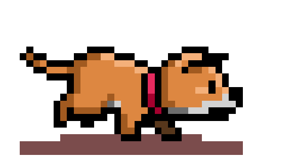

### 👋 ¡Hola! Bienvenido a mi espacio en GitHub

Me apasiona aprender sobre programación,
desarrollar aplicaciones y explorar nuevas
tecnologías para mejorar mis habilidades.

  
  

💻 Aprendiendo, programando y construyendo nuevos proyectos.

---

## 👨‍💻 Sobre mí

- 🎓 Estudiante de Ingeniería de Software.
- 💻 Con conocimientos en desarrollo web y programación.
- 📚 En constante aprendizaje de nuevas tecnologías.
- 🛠️ Interesado en crear soluciones mediante software.
- 🚀 Utilizo GitHub para compartir mis trabajos y proyectos.

---

## 🛠️ Tecnologías y herramientas

### Lenguajes

### Frameworks y librerías

### Control de versiones

---

## 📂 Mis repositorios

En mi GitHub comparto ejercicios de programación,  
trabajos académicos y proyectos de desarrollo de software.

---

---

## 📊 Mis estadísticas de GitHub

---

## ✨ Un poco más sobre mí

  

---

## 🐍 Mis contribuciones

---

 

<i>Gracias por visitar mi perfil.</i>

